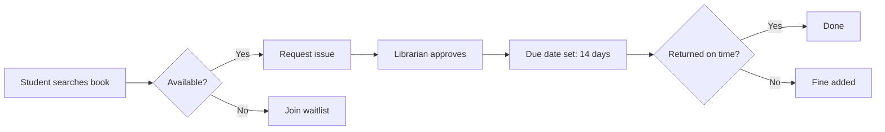

## Goal

Build a web app where students can **search, borrow and return books**, and librarians can manage stock and fines.

## Modules

| Module | What it does | Owner |
|---|---|---|
| Auth | Login, roles (student / librarian) | Rahim |
| Catalog | Search books by title, author, ISBN | Karim |
| Borrowing | Issue, return, due-date reminders | Nadia |
| Reports | Overdue list, popular books | Sumi |

## Borrowing flow

## Timeline

1. **Week 1–2:** database design and auth
2. **Week 3–4:** catalog and search
3. **Week 5–6:** borrowing and fines
4. **Week 7:** reports, testing, deployment

> Tech stack: Flask + MySQL, deployed on a free Render instance.

## Risks

- Search can get slow with many books → add a full-text index.
- Students forget due dates → email reminder two days before.
